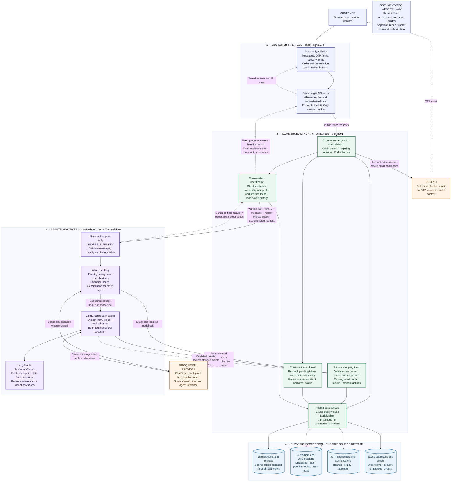
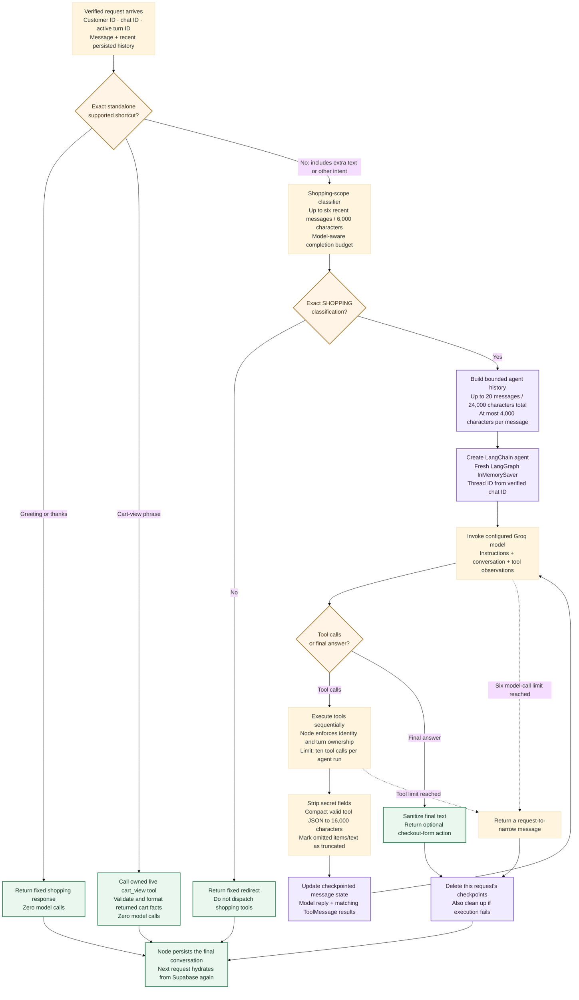

# Veyrix architecture

> A detailed visual guide to the shopping application: how requests move, where memory lives, which service authorizes each action, and how orders are committed.

[Project overview](README.md) · [File-by-file reference](ARCHITECTURE_INDEX.md) · [Commerce setup](setup/node/README.md) · [Agent setup](setup/python/README.md)

The diagrams are separated by responsibility so individual labels remain readable. On GitHub, open a rendered diagram's expanded view to inspect it at a larger size.

## 1. Complete system overview

**Read from top to bottom.** Solid arrows show requests or data access; dotted arrows show returned information or explanatory relationships. The documentation site is independent of customer commerce operations.



**The central boundary:** the agent proposes tool calls; Node validates and executes them. The model has no arbitrary SQL tool, no direct database connection, and no tool that commits an order or cancellation.

Python's port is configurable through `SHOPPING_PORT`; this workspace may use `8002`. Node's `PYTHON_API_URL` must match. The documentation site normally runs on `5173`.

## 2. One conversation turn, step by step

This sequence shows a request that uses the agent. Exact greetings and simple cart reads follow the shorter paths in the next diagram.

```mermaid
%%{init: {"theme":"base","themeVariables":{"fontSize":"17px"},"sequence":{"actorMargin":50,"messageMargin":40,"noteMargin":20}}}%%
sequenceDiagram
    autonumber
    actor Customer
    participant Chat as React chat + proxy
    participant Node as Node commerce API
    participant DB as Supabase
    participant Python as Python worker
    participant LLM as Groq

    Customer->>Chat: Send a shopping message
    Chat->>Node: POST /api/chat + session cookie
    Node->>DB: Resolve session, owned chat and customer profile
    Note over Node,DB: Reject expired sessions, ended chats,<br/>incomplete profiles or an active competing turn
    Node->>DB: Acquire a three-minute turn lease
    DB-->>Node: Persisted conversation and current state
    Node-->>Chat: SSE checking / working status
    Node->>Python: POST /api/respond with verified IDs and history
    Python->>Python: Validate request and bound recent context
    Python->>LLM: Classify shopping relevance
    LLM-->>Python: SHOPPING or OFF_TOPIC

    alt Off-topic or unrecognized classification
        Python-->>Node: Fixed shopping redirect
    else Shopping request
        Python->>Python: Create agent and fresh checkpoint memory
        loop Up to six agent model calls and ten tool calls
            Python->>LLM: System instructions + messages + tool definitions
            LLM-->>Python: Final answer or structured tool calls
            opt Tools requested
                Python->>Node: POST /internal/tools + service key + active turn
                Node->>DB: Verify owner, active lease and unexpired authorization
                Node->>DB: Execute allowed catalog/cart/order operation
                DB-->>Node: Live result or persisted change
                Node-->>Python: Tool result
                Python->>Python: Remove private fields; compact valid JSON<br/>Append observation to checkpointed message state
            end
        end
        Python->>Python: Filter final answer and delete temporary checkpoints
        Python-->>Node: Answer and optional checkout action
    end

    Node-->>Chat: SSE saving status
    Node->>DB: Recheck lease; append user/assistant messages<br/>Clear lease in the same committed update
    DB-->>Node: Save confirmed
    Node-->>Chat: Final result + current pending UI state
    Chat-->>Customer: Display saved answer and relevant controls
    Note over Customer,Node: Progress is streamed; raw model tokens are not.<br/>A conversation reply cannot confirm a purchase.
```

If the request fails after dispatch, a cart tool may already have changed state. Node reports `request_outcome_unknown`; the interface hides Retry and asks the customer to reload and check the cart. Disconnecting the browser does not automatically replay an operation or interrupt required persistence.

## 3. Agent decisions and memory lifecycle



### Memory is split deliberately

| Memory / state | Owner | Lifetime | What it contains |
| --- | --- | --- | --- |
| Full conversation | Node + Supabase | Durable until explicitly deleted | Saved user and assistant messages |
| Agent working state | LangGraph `InMemorySaver` | One Python request | Bounded history, model responses, tool observations |
| Shopping state | Node + Supabase | Durable | Cart, pending review, saved addresses, orders |
| Authentication | Node + Supabase | Expiring | Session-token hashes, OTP-challenge hashes, attempts and expiry |
| Browser display state | React | Current browser experience | Rendered messages, open forms, progress and pending controls |

If agent execution raises an error, its checkpoints are still deleted, but Node does not append a successful user/assistant transcript pair. A limit response is a normal returned answer and can be saved.

There is **no vector store, automatic long-term preference learning, or persistent Python customer-session cache**. A new request reconstructs context from the verified saved conversation. Full transcripts are preserved even when the model's input is shortened.

## 4. Checkout and cancellation: explicit write boundaries

```mermaid
%%{init: {"theme":"base","themeVariables":{"fontSize":"17px"},"sequence":{"actorMargin":55,"messageMargin":40}}}%%
sequenceDiagram
    autonumber
    actor Customer
    participant UI as Shopping interface
    participant Agent as AI agent
    participant Node as Commerce authority
    participant DB as Supabase transaction

    Customer->>UI: Ask to check out in chat
    UI->>Node: POST /api/chat + session cookie
    Node->>Agent: Verified request through Python worker
    Agent->>Node: prepare_order tool
    Node-->>Agent: Checkout-form action
    Agent-->>Node: Answer + checkout action
    Node->>DB: Persist chat reply and release turn lease
    Node-->>UI: Checkout action through saved chat response
    UI-->>Customer: Show saved-address selector / delivery form
    Customer->>UI: Choose or save a delivery address
    UI->>Node: POST /api/checkout/prepare
    Node->>DB: Verify owned chat and address; read live items
    Node->>DB: Save item, price and delivery snapshot<br/>Pending confirmation expires in five minutes
    Node-->>UI: Review summary + confirmation control

    Note over Agent,DB: Preparation does not reserve inventory.<br/>The agent has no commit tool.

    Customer->>UI: Click Confirm order
    UI->>Node: POST /api/chat/confirm + confirmation ID
    Node->>DB: Begin serializable transaction
    Node->>DB: Verify ownership and pending-token expiry<br/>Recheck cart, prices, stock and delivery charges
    alt Details changed or stock is insufficient
        DB-->>Node: Reject / roll back
        Node-->>UI: Request a fresh review
    else Review remains valid
        Node->>DB: Conditionally reduce stock<br/>Create order, items and event<br/>Save answer; clear cart and pending state
        DB-->>Node: Commit
        Node-->>UI: Confirmed pay-on-delivery order
    end

    opt Customer later requests cancellation
        UI->>Node: Prepare owned-order cancellation
        Node->>DB: Check pre-dispatch eligibility; save pending review
        Node-->>UI: Cancellation confirmation control
        Customer->>UI: Click Confirm cancellation
        UI->>Node: Confirm pending cancellation
        Node->>DB: Recheck ownership, token and current status<br/>Cancel, restore stock, record event atomically
        Node-->>UI: Persisted cancellation outcome
    end
    Note over Node,DB: Repeated successful confirmations return the existing outcome.<br/>They must not repeat order creation or stock restoration.
```

## 5. Data and trust boundaries

| Boundary | Required checks / responsibilities |
| --- | --- |
| Browser → chat proxy | Supported routes, same-origin policy, body-size limits; no backend credentials injected into client code |
| Protected browser API → Node | HttpOnly cookie, valid unexpired session, request schemas, owned records; authentication start/verify routes instead validate the OTP flow before issuing a session |
| Node → Python | `SHOPPING_API_KEY`; verified customer/chat/turn identifiers supplied by Node |
| Python → Node tools | `INTERNAL_API_KEY`; active turn lease, customer ownership, unexpired verified session |
| Node → database | Prisma-bound data values, schema-identifier validation, transactional commerce writes |
| Model/tool data → UI | Private fields removed from model observations; final text filtering; explicit confirmation controls |
| Database → future requests | Owned transcript retrieval; fresh verification for saved-chat restoration |

### Persisted records

| Tables / views | Responsibility |
| --- | --- |
| `customers` | Customer identity and verified contact association |
| `veyrix_auth_sessions`, `veyrix_otp_challenges` | Session hashes, OTP hashes, expiry and attempt tracking |
| `veyrix_chats` | Transcript JSON, cart, pending action, status and turn lease |
| `veyrix_addresses` | Customer-owned saved delivery details |
| `live_products`, `live_reviews` | Views over the authoritative public catalog; no copied catalog cache |
| `orders`, `order_items`, `order_events` | Durable purchase snapshots, line items and order lifecycle events |

OTP validity is **10 minutes**, verified-session validity **30 minutes**, pending confirmation validity **5 minutes**, and the chat turn lease **3 minutes**. Session expiry and ending a chat do not erase its stored transcript. Automated retention/deletion is not enabled.

## 6. From the diagrams to the code

| Diagram responsibility | Main implementation |
| --- | --- |
| Shopping interface and forms | [`chat/src/App.tsx`](chat/src/App.tsx), [`commerce-cards.tsx`](chat/src/components/commerce-cards.tsx) |
| Same-origin proxy | [`chat/server/api.mjs`](chat/server/api.mjs) |
| Browser API and progress responses | [`app.ts`](setup/node/src/app.ts), [`chat-stream.ts`](setup/node/src/chat-stream.ts) |
| Verification and sessions | [`auth.ts`](setup/node/src/auth.ts), [`security.ts`](setup/node/src/security.ts) |
| Tool execution and checkout | [`commerce.ts`](setup/node/src/commerce.ts) |
| Transactions and database models | [`store.ts`](setup/node/src/store.ts), [`schema.prisma`](setup/node/prisma/schema.prisma) |
| Private Python request contract | [`api/stateless.py`](setup/python/api/stateless.py) |
| Agent, shortcuts and temporary memory | [`agent/stateless.py`](setup/python/agent/stateless.py) |
| Model and reasoning settings | [`agent/llm_client.py`](setup/python/agent/llm_client.py) |
| Documentation diagrams in the website | [`Architecture.tsx`](web/src/pages/Architecture.tsx), [`ai-agent-pipeline.tsx`](web/src/components/ui/ai-agent-pipeline.tsx) |

For the complete inventory, dependencies, administrative utilities and verification commands, see [ARCHITECTURE_INDEX.md](ARCHITECTURE_INDEX.md).
