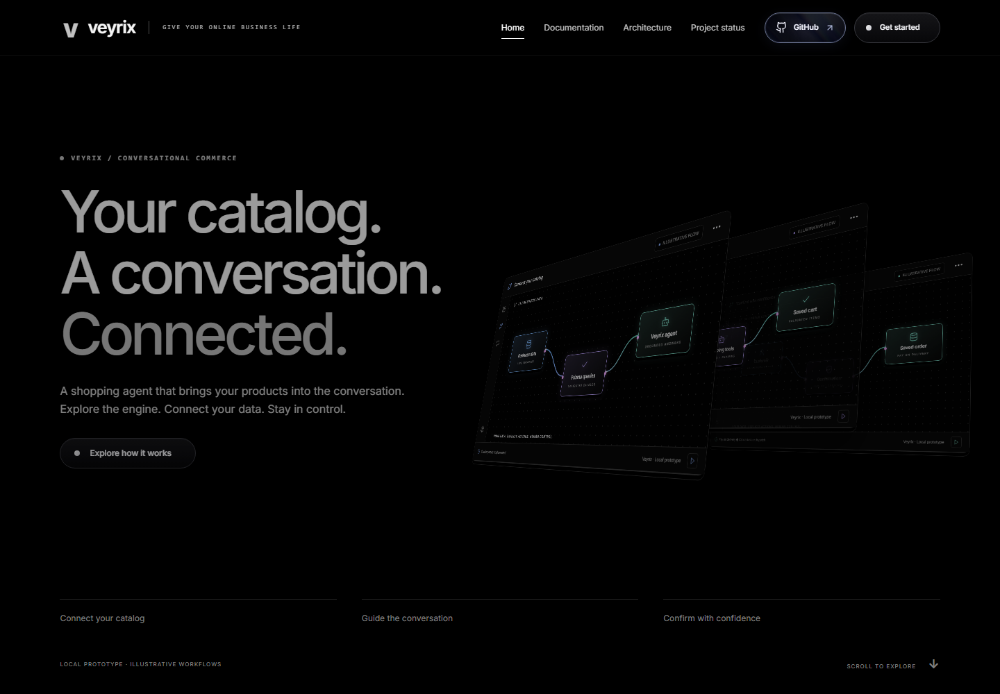
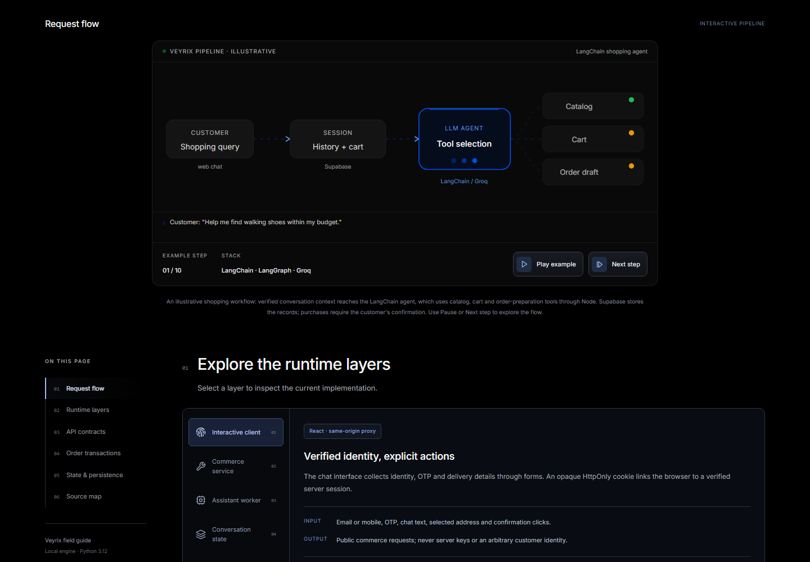
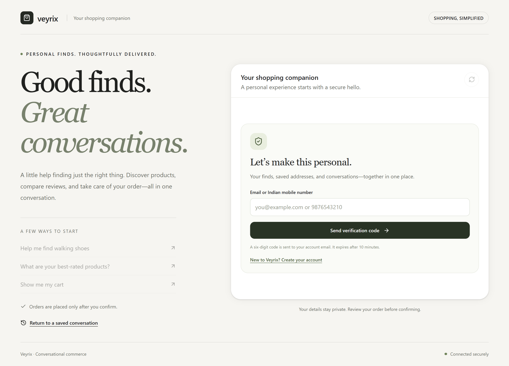
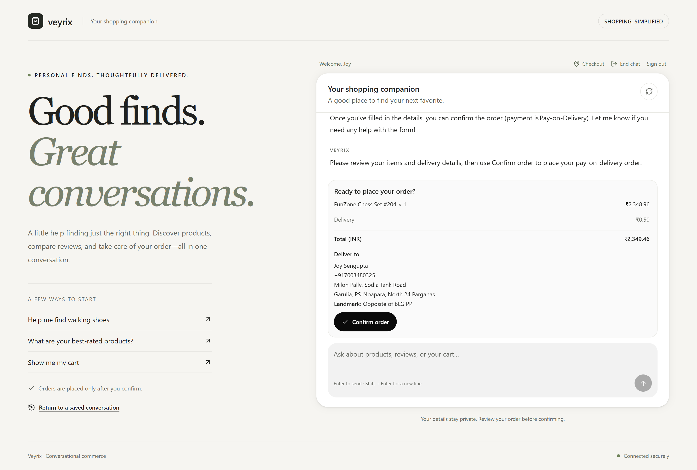
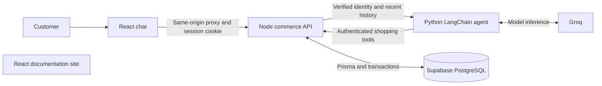

<div align="center">


# Veyrix

### Your catalog. A conversation. Connected.

A conversational commerce prototype that connects AI-assisted product discovery with verified customers, live inventory, and explicit checkout.

[Live documentation](https://veyrixagent.vercel.app) · [Explore the architecture](ARCHITECTURE.md) · [Run the commerce service](setup/node/README.md) · [Run the AI agent](setup/python/README.md) · [Documentation source & setup](web/README.md)


</div>

---

## At a glance

Veyrix brings shopping into a conversation while keeping customer identity, prices, stock, and order decisions under server control. The agent can find products, inspect reviews, manage a cart, and prepare an order. Customers confirm purchases and cancellations through dedicated UI controls.

The repository includes a shopping interface, a commerce API, a Python AI worker, and a separate documentation website.

## Website preview

Real captures of the local documentation website. The workflow illustration is explanatory, not live production telemetry. Select an image to view it at full size.

<table>
  <tr>
    <th width="50%">Landing page</th>
    <th width="50%">Architecture &amp; request flow</th>
  </tr>
  <tr>
    <td><a href="docs/images/docs-home.png"></a></td>
    <td><a href="docs/images/docs-architecture.png"></a></td>
  </tr>
</table>

## Demo Chat showcase

<table>
  <tr>
    <th width="50%">OTP Based Authentication Before Chat</th>
    <th width="50%">Order Confirmation</th>
  </tr>
  <tr>
    <!-- Replace the first placeholder src with docs/images/chat-discovery.png. -->
    <td align="center"></td>
    <!-- Replace the second placeholder src with docs/images/chat-checkout.png. -->
    <td align="center"></td>
  </tr>
</table>

## For More Chat-Detailing Click [Demo-Shots](./docs/images/)

## Capabilities

| Area | What Veyrix does |
| --- | --- |
| Product discovery | Searches the live catalog and retrieves product details, prices, stock, and reviews through tools. |
| Verified access | Uses email OTP verification, expiring sessions, and customer-scoped access to chats and orders. |
| Cart management | Adds, removes, and updates quantities against current product availability. |
| Guided checkout | Collects an Indian delivery address, prepares a review, and requires explicit confirmation. |
| Order management | Retrieves owned orders and prepares eligible cancellations before dispatch. |
| Conversation recovery | Persists chat history in Supabase and supports restoration after fresh verification. |
| Responsive experience | Includes chat progress updates and mobile layouts. |

Payment is **pay on delivery**. Adding to a cart or replying “yes” does not place an order.

## Architecture



| Service | Location | Responsibility | Local port |
| --- | --- | --- | --- |
| Shopping interface | [`chat/`](chat/) | Customer forms, conversations, and confirmation controls | `5174` in development |
| Commerce API | [`setup/node/`](setup/node/) | Authentication, authorization, catalog access, and durable state | `8001` |
| AI worker | [`setup/python/`](setup/python/) | LangChain agent execution, model access, and temporary working memory | `8000` by default |
| Documentation | [`web/`](web/) | Product overview, architecture, setup, and demonstration guides | Usually `5173` |

`SHOPPING_PORT` can override the Python port; this workspace may use `8002`. Node's `PYTHON_API_URL` must match it. The documentation site is independent of customer sessions and does not query private shopping data.

See the [file-by-file architecture reference](ARCHITECTURE_INDEX.md) for module responsibilities, API contracts, and state lifetimes.

## AI & memory

- **Agent framework:** `langchain.agents.create_agent` coordinates the model and shopping tools.
- **Model provider:** `ChatGroq` connects to the model selected by `GROQ_MODEL`. Supported GPT-OSS models use low reasoning effort by default, with a configurable override.
- **Short-term working memory:** a fresh LangGraph `InMemorySaver` stores message/tool state during each request and is cleaned up afterward.
- **Durable history:** Node stores the full conversation in Supabase and supplies recent verified context to the worker. The model receives up to 20 messages within a 24,000-character budget.
- **Bounded execution:** agent runs allow up to six model calls and ten tool calls. Tool execution is sequential; relevance classification is separate.
- **Faster common requests:** exact greetings, thanks, and cart-view requests avoid model calls. Cart reads still fetch live, authorized data.

There is no separate vector database or cross-chat preference-learning system. The browser receives fixed progress events followed by the saved final answer, rather than unfiltered model tokens.

## Technology stack

| Layer | Technologies |
| --- | --- |
| Interfaces | React 19, TypeScript, Vite, Tailwind CSS, Lucide icons |
| Documentation motion | Framer Motion, GSAP, SVG, WebGL with a fallback renderer |
| AI orchestration | LangChain, LangGraph, Groq |
| Python service | Flask, Waitress, Python 3.12 |
| Commerce service | Node.js, Express 5, Zod, Prisma |
| Persistent storage | Supabase PostgreSQL |
| Verification email | Resend |
| Verification tools | pytest, Node's test runner, TypeScript, Vite builds |

## Run locally

### 1. Install dependencies

Prerequisites: **Node.js 22.12+**, **Python 3.12**, a configured Supabase PostgreSQL database, Groq access, and Resend email configuration. These commands use PowerShell from the repository root.

```powershell
git clone https://github.com/0xJoy07/Veyrix.git
cd Veyrix

npm ci --prefix setup/node
npm ci --prefix chat
npm ci --prefix web

python -m venv setup/python/.venv
.\setup\python\.venv\Scripts\python.exe -m pip install -r setup/python/requirements-dev.txt
```

For the recorded Python dependency versions, use [`requirements-lock.txt`](setup/python/requirements-lock.txt) instead.

### 2. Configure services

Create missing environment files without overwriting existing configuration:

```powershell
if (!(Test-Path setup/node/.env)) { Copy-Item setup/node/.env.example setup/node/.env }
if (!(Test-Path setup/python/.env)) { Copy-Item setup/python/.env.example setup/python/.env }
if (!(Test-Path chat/.env)) { Copy-Item chat/.env.example chat/.env }
```

| File | Required configuration |
| --- | --- |
| `setup/node/.env` | Supabase URLs, OTP secret, internal service keys, Resend key/sender, and the Python service URL |
| `setup/python/.env` | Groq key/model, matching internal service keys, and the commerce URL |
| `chat/.env` | Commerce URL when it differs from the default |

Keep `SHOPPING_API_KEY` and `INTERNAL_API_KEY` consistent between the Node and Python services. Keep all credentials server-side; never place them in `VITE_*` variables.

Follow the [commerce setup guide](setup/node/README.md) to inspect and prepare the existing database, including its additive upgrade and live-catalog views. **Do not reset an existing database or use destructive schema-push options.** Then generate the Prisma client:

```powershell
npm run prisma:generate --prefix setup/node
```

Resend requires a suitable sender address. Its test sender is restricted to the account owner's address; a verified domain is needed for other recipients.

### 3. Start the services

Run each command in its own terminal:

```powershell
# Commerce API
npm run dev --prefix setup/node

# AI worker
.\setup\python\.venv\Scripts\python.exe setup/python/main.py

# Shopping interface
npm run dev --prefix chat

# Documentation website
npm run dev --prefix web
```

Open **[the shopping app](http://127.0.0.1:5174)** and the documentation URL printed by Vite, usually **[port 5173](http://127.0.0.1:5173)**. Match Node's `PUBLIC_ORIGIN` to the shopping app's origin.

Alternatively, `./start-dev.ps1` opens terminals for Node, Python, and chat; start the documentation site separately. Stop existing instances before starting another service on the same port.

## Security & data boundaries

- Email OTPs expire after ten minutes; attempts and repeated requests are limited. Verified sessions expire after thirty minutes.
- Server-side ownership checks protect chats, addresses, and orders. A record ID alone does not grant access.
- The model cannot commit purchases or cancellations. Five-minute confirmation reviews are revalidated inside database transactions.
- Prisma and SQLAlchemy bind data values; configured schema identifiers use an allowlist. Regression tests cover SQL-looking inputs and ownership boundaries.
- Message contents, OTPs, API keys, and personal details are excluded from stage timing logs.
- A failed reply can follow a successful cart tool. Uncertain outcomes suppress the retry button and ask the customer to inspect saved state first.

This is a **working prototype**. Production hosting, HTTPS, operational monitoring, and a retention/deletion policy remain deployment responsibilities. Ending a chat or expiring a session does not automatically delete its saved transcript. Legacy customer records without verified email associations require administrator review before access.

## Verification

```powershell
.\setup\python\.venv\Scripts\python.exe -m pytest setup/python/tests -q
npm test --prefix setup/node
npm test --prefix chat

npm run build --prefix setup/node
npm run build --prefix chat
npm run build --prefix web
```

Default tests use isolated fixtures and mocked services. Optional remote-database integration checks are described in the [commerce guide](setup/node/README.md). Badges above identify the stack; they are not live CI or security-certification badges.

## Project layout

```text
Veyrix/
├── chat/                   # Customer-facing shopping interface and proxy
├── setup/
│   ├── node/               # Commerce API, Prisma schema, and transactions
│   └── python/             # LangChain worker and supporting utilities
├── web/                    # Documentation website
├── docs/images/            # README screenshots and chat showcase assets
├── ARCHITECTURE_INDEX.md    # Detailed file-by-file reference
└── start-dev.ps1            # Local service launcher
```

---

<div align="center">

**Veyrix — give your online business life.**

[Repository](https://github.com/0xJoy07/Veyrix) · [Architecture](ARCHITECTURE_INDEX.md) · [Setup guide](setup/node/README.md)

</div>
